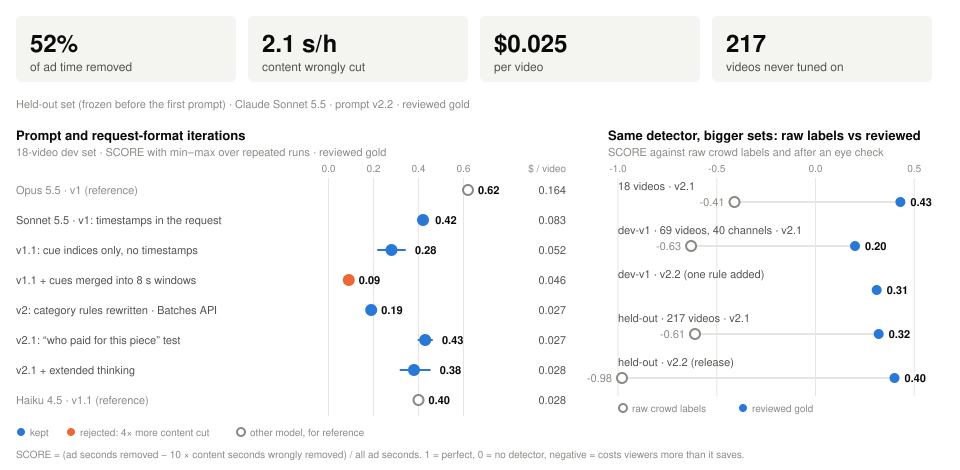
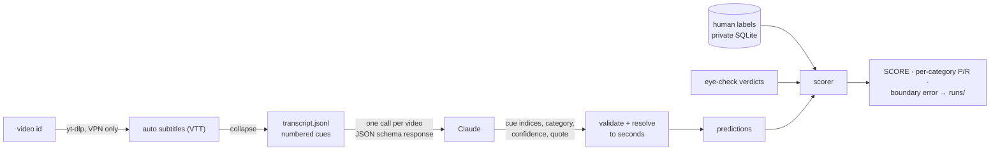

# native-ad-skip-eval

Can an LLM find sponsor segments in long videos from the auto-generated subtitles alone, well
enough to skip them without asking the viewer? This is the measurable half of a private product
(a browser extension where viewers mark ad segments in videos and others skip them, 10k users):
the **detector**, the **eval harness** that scores it against ~12.5k human labels, the versioned
prompts and the numbers of every run. Go. The dataset stays private, so this README is the
write-up, not a tutorial.

<picture>
  <source media="(prefers-color-scheme: dark)" srcset="docs/results-dark.svg">
  
</picture>

**→ [How the detector got here](docs/iterations.md):** fifteen measured steps, what each changed,
what was kept and what was rejected.

The headline is one run on videos the detector was never tuned on, and it passes the release gate
fixed before that set was opened (SCORE ≥ 0.15, wrongly cut ≤ 6 s/h). The same run scored against
the raw human labels looks like a failure (−0.89): most of the gap was ads the humans had not
marked, which is the main finding of the project.

## What the project answers

The product has labels from ~1,200 people, but 92% of videos have a single labeller, and each
person marks the ad they noticed, not all of them. The questions are engineering questions:

1. How good is an LLM at this task, measured in seconds of ad removed and content wrongly removed,
   on videos it was never tuned on?
2. What does it cost per video, and how much quality is lost with a cheaper model or a cheaper
   request format?
3. What can the product safely automate: skip without asking, or only propose?

Every change to the prompt, the model or the request format gets a before/after number in
`runs/`, and the dataset was split into dev and held-out before the first prompt was written.

## Results

**One number.** Twelve precision/recall metrics are not a decision, so each run is summarised as

```
SCORE = (ad seconds removed − 10 × content seconds wrongly removed) / all ad seconds
```

under the product's own skip rule (sponsor from `medium` confidence, self-promotion only at
`high`, segments of at least 5 s). 1.0 means every ad second removed and nothing else, 0 means
no detector, negative means the detector costs viewers more content than it saves them. The factor
10 is the purpose of the system written as arithmetic: the player skips without asking, so a cut
second of real content is much worse than a missed second of ad.

**Gold.** The raw labels are a union of partial human markups; "reviewed" gold is the same labels
after a person checked every stretch where the detector and the humans disagreed, blind to which
run produced it. Raw labels are never edited; verdicts (`gold_missing`, `gold_wrong`,
`definition_unclear`, `model_wrong`) are stored on top and applied at scoring time.

| Set | Videos | Model, prompt | SCORE | ad time removed | content wrongly cut | $ / video |
|---|---|---|---|---|---|---|
| **held-out** (frozen before any prompt work, scored once) | 217 | Sonnet 5.5, v2.1, batch | **0.34** | 44% | 1.3 s/h | 0.025 |
| dev-v1 | 69 | Sonnet 5.5, **v2.2** (skit lead-in belongs to the ad), batch | 0.33 (0.27–0.39, n=2) | 65% | 3.8 s/h | 0.022 |
| dev-v1 (69 videos, 40 channels) | 69 | Sonnet 5.5, v2.1, batch | 0.20 (0.17–0.23, n=2) | 56% | 5.0 s/h | 0.022 |
| dev-v1, thinking + high effort | 69 | Sonnet 5.5, v2.1, batch | 0.24 (0.21–0.27, n=2) | 55% | 5.2 s/h | 0.022 |
| v0 (first 18 videos) | 18 | Opus 5.5, v1, API | 0.62 | — | — | 0.17 |
| v0 | 18 | Sonnet 5.5, v1.1 | 0.30 (0.22–0.36, n=5) | — | — | 0.054 |
| v0 | 18 | Haiku 4.5, v1.1 | 0.37 | — | — | 0.028 |

Held-out, segment level, reviewed gold, IoU ≥ 0.3: any-ad precision 0.77 / recall 0.78;
sponsor 0.70 / 0.64; self-promotion 0.76 / 0.86. In seconds, any-ad precision is 0.95 and
recall 0.49: what the detector cuts is almost always an ad, and it leaves about half of the ad
time in. Haiku's v0 row covers the 12 of 18 videos where its output passed validation.

**What the numbers taught me**

- **Raw crowd labels are a floor, not a measurement.** On dev-v1 the headline went from −0.48 to
  0.20 after the eye check: about 70% of the "wrongly cut" seconds were real ads nobody had
  marked, ~20% were videos whose subtitle track did not match the video, under 10% were model
  errors. The held-out set repeated the pattern (−0.89 → 0.34).
- **The human–human ceiling is unusable as a bar.** Scoring each contributor against the union of
  the others gives SCORE −5.96: a person's seconds are confirmed by someone else 22% of the time
  and cover 17% of what the others marked. "AI at human level" would be passed by anything, so the
  gate had to be defined on reviewed gold plus a ceiling on wrongly cut content.
- **Opus is about twice Sonnet on this task; Sonnet variants overlap within their own noise.**
  Running the same configuration twice before comparing two configurations is the rule here: the
  repeat spread is ±0.03 on dev-v1 and ±0.1 on 18 videos, where one 300 s block decides the score.
- **Thinking is not worth paying for.** A gain seen through `claude -p` did not reproduce on the
  API; on dev-v1 the gap (0.04) sits inside the repeat range.
- **Cost went from $0.085 to $0.026 per video with no quality change.** Spend is 99% input tokens.
  Dropping cue timestamps from the request (−36%: the model answers with cue indices and never
  reads the times) and the Message Batches API (−50%). Merging cues into 8 s windows looked free
  on segment metrics and was rejected after the seconds metric showed 4× more content cut.
- **Subtitle timing is a product risk, not a one-off.** About one video in five has a subtitle
  timeline off by more than 2 s against the audio. No audio analysis in the product; instead a
  cheap gate (last cue ends > 3 s after the video → do not trust the detector's times on that
  video), and the eval reports the clean-timeline slice next to the full set (`rank -timing-clean`).

Aggregates per run: `runs/<run>/metrics.json` (cost, tokens, validity) and
`runs/<run>/score-<settings>.json` (matching, per-confidence precision, boundary quantiles). The
decision log with rejected options lives with the product; the measurement rules it produced are
in the next two sections.

## How it works



One model call per video: the prompt (`prompts/v2.2.md`, current) as system text, the transcript as
numbered cues (`[12] 549.4-551.4: text`) in the user message, a JSON schema as the response
format. The model returns **cue indices, never timestamps**; the code maps indices to seconds and
rejects an index outside the transcript, a reversed or an overlapping segment. The scorer merges
human labels per video and category (union across contributors), filters predictions by the
product thresholds, matches one-to-one by intersection-over-union, and reports precision/recall
per category and for "any ad" (what a skip button sees), precision per confidence level, boundary
error of matched pairs, and SCORE. One paid run is scored under many settings because predictions
are stored raw.

## Design decisions

**Held-out by hash, frozen before the first prompt.** 20% of the assessor-labelled videos
(`sha256(provider:id) mod 5 == 0`) were listed before any prompt run and never opened during
prompt work. A hash bucket instead of a random seed: the list is reproducible from the data and a
video never changes side when labels arrive. The gate values (SCORE ≥ 0.15, ≤ 6 s/h) were
fixed from dev-v1 and written down before the held-out run was scored. Cost: one honest number
per milestone instead of a number per iteration, and the held-out could have failed.

**Indices, not timestamps.** A segment can only start and end where the transcript has text, and
the model cannot invent a number. Consequence, measured and reported separately: text-based
boundaries sit inside the audio-based human ones (median start +3.6 s, end −3.9 s on v0), which
is why the hit rule is a loose IoU 0.3 and boundary quality is its own metric.

**Gold is reviewed, never edited.** Verdicts live in their own table with reviewer, date and the
run the sheet came from; `-gold reviewed` applies them at scoring time. A review sheet built from
one run's disagreements favours that run (its predictions become gold), so sheets are built from
the union of all runs with the source hidden (`adskip sheet`), and raw and reviewed numbers are
reported side by side.

**One headline number, a table for explanation.** SCORE with the product's thresholds and a
factor the product owner can argue about (`-lambda`). `adskip rank` compares variants in one line
each, with the spread over repeated runs and the slice without the channel that dominates the
set. Limit: one number hides trade-offs; the detailed table stays one flag away.

**The detector does not know the store.** `internal/detector` imports only the transcript
packages so the same code can run inside the product against its own database; the SQLite eval
store is for offline scoring only. The product runs a copy of these packages and the prompt
(synced from a committed checkout of this repo), so detector and prompt changes are made and
scored here first. The provider layer (`internal/provider`) is the only
platform-specific code; everything is keyed by `(provider, native_id)`.

**Privacy is a test, not a convention.** Nothing that identifies a video or a contributor enters
the repository: a test scans every tracked file and file name for video and channel ids and fails
the build on a hit; `.gitignore` is the second line of defence. Subtitles are fetched only behind
a VPN: `fetch` resolves the external IP first and refuses to run from a listed home IP, or when
the list is missing. Labels are exported with hashed contributor ids; no platform account or
cookies are used.

**Three transports, each with a job.** Messages API for headline numbers and exact usage (with
constrained decoding of the schema); Batches API for every offline run at half price, resumable
by batch id; `claude -p` for cheap experiments on a subscription (schema through a synthetic tool
call, harness overhead cut from 28.8k to 419 tokens with flags). Calibrated on the same videos:
Opus gives identical metrics on the API and through `-p`; Sonnet differs by less than two API runs
of the same configuration.

## What you can run

The data is private, so a stranger cannot reproduce the table. What is checkable without it:

```sh
git clone https://github.com/bayanovea/native-ad-skip-eval && cd native-ad-skip-eval
go build -o adskip ./cmd/adskip
go test ./...          # scorer, validation, VTT collapse, gold import, policy scan; no network
./adskip               # every command and flag
cat runs/2026-10-18-claude-sonnet-5-5-v2.1-batch-nt/config.json   # model, prompt sha, prices
```

Every run directory holds the exact prompt, the configuration and the aggregates the tables above
are made of. The prompts are in `prompts/`, versioned by file name; the sha256 is in each run's
config.

With your own data the pipeline is: `fetch` (subtitles → transcripts, cached, resumable, VPN
required) → `import` (human labels as JSONL) → `evalset` (held-out and dev lists by hash) →
`detect -dry-run` (sizes and a cost estimate, no calls) → `detect` → `score` / `rank`. Commands,
formats and the data-root layout are under the fold below. Requirements: Go 1.27+, `yt-dlp` on
`PATH`, a Console API key in `~/.config/adskip/anthropic.key` (or `ADSKIP_ANTHROPIC_KEY_FILE`).

## Status and limits

Done: fetch and transcript cache, anonymised gold import, held-out and dev sets, detector with
three transports, scorer with seconds metrics and review layer, blind review sheets, per-video
subtitle offsets, timing gate, held-out measured once. The product decision this feeds (auto-skip
on videos nobody has marked, at `high` confidence only) is taken from these numbers.

What is rough: recall. The detector leaves about half of the ad time in, and the review sheets
only cover stretches it flagged, so the misses are the least examined error class. `intro` and
`credits` are not detected (no transcript signal). About 25% of videos have no subtitle track at
all, which caps coverage before any model runs. One provider (`main`); `youtube` and `rutube` wait
for human labels. No regression test in `go test` yet; a run is compared by hand with `rank`.

What I would do differently: define the seconds metric and SCORE before the first run instead of
after a table of twelve numbers; review a random control sample from day one, not only
disagreements, so the absolute level has an interval; and treat subtitle timing as an input
quality problem from the first fetch rather than discovering it on the third set.

<details>
<summary>Commands</summary>

```sh
# Subtitles → transcripts for every id in an eval set. Cached videos are skipped; a rerun after
# a partial failure retries only what is missing. Refuses to run from a home IP.
./adskip fetch -set heldout
./adskip fetch -provider main -ids /path/ids.txt
./adskip collapse -id c1_1001           # rebuild one transcript from the cached VTT, no network

# Human labels (anonymised JSONL export) into the eval store. Idempotent.
./adskip import -file $ADSKIP_DATA/gold-v1.jsonl
./adskip evalset heldout                      # 20% of assessor videos by hash bucket
./adskip evalset v0                           # 10 assessor + 10 multi-contributor videos

# Detector. -dry-run prints sizes and a cost estimate without a call.
./adskip detect -set dev -dry-run
./adskip detect -set dev -model claude-sonnet-5-5 -transport batch -prompt prompts/v2.2.md -no-times
./adskip detect -set dev -model claude-sonnet-5-5 -transport cli -prompt prompts/v2.2.md -no-times [-thinking -effort high]

# Scoring. Thresholds are flags; predictions are stored raw.
./adskip score -run RUN -iou 0.3 -gold reviewed            # headline; -detail for the full table; -list for misses
./adskip rank -timing-clean "v2.1=RUN1,RUN2" "think=RUN3"  # variants side by side, spread over repeats
./adskip compare -a RUN1 -b RUN2                           # agreement between two runs, no gold needed
./adskip ceiling                                           # each human vs the union of the others

# Review loop: blind sheet over several runs → verdicts (TSV) → applied by -gold reviewed.
./adskip sheet -runs RUN1,RUN2 -out sheet.md
./adskip review -file verdicts.tsv -run RUN1 -date 2026-10-19
./adskip sheet -misses -runs RUN1,RUN2 -out misses.md       # human-labelled ads no run found
./adskip review -misses -file misses.verdicts.tsv -run misses-RUN -date 2026-10-22   # ad → gold_valid, not → gold_wrong
./adskip offset -id ID -seconds 11 -date 2026-10-12         # per-video subtitle timeline offset
./adskip flags -file video-flags.tsv                        # assessor flags (track ≠ video)
```

</details>

<details>
<summary>Scorer rules</summary>

Human labels of one video and category are merged across contributors (union of overlapping
intervals). Predictions are filtered (`-min-seconds`, `-min-confidence`, per-category product
thresholds), then matched one-to-one with merged gold of the same category, greedily by
intersection-over-union, a hit at `IoU ≥ 0.3`. Reported per category and for `any_ad`
(categories collapsed, adjacent segments merged on both sides): precision, recall, F1 in segments
and in seconds, precision per confidence level, boundary error of matched pairs (median signed,
p50/p90 absolute, share within 2 / 5 / 10 s), SCORE.

`-gold reviewed` applies verdicts on top of the raw labels: `gold_missing` adds an interval,
`gold_wrong` cuts the reviewed stretch out of the overlapping labels, `definition_unclear` cuts it out of
both sides (only the stretch: a verdict on the uncovered rest of a label must not drop the part the model
found), `model_wrong` and `gold_valid` change nothing. `-exclude-owner` drops one channel;
`-timing-clean` drops videos with a subtitle track that ends after the video or an assessor's
"track ≠ video" flag; `-videos FILE` scores a listed subset.

</details>

<details>
<summary>Transcript format and data root</summary>

```jsonl
{"kind":"meta","native_id":"c1_1001","provider":"main","duration":2311.0,"lang":"ru","track_type":"auto","cues":1480,"words":15012,"fetched_at":"2026-10-12T10:00:00Z"}
{"kind":"cue","start":46.86,"end":48.27,"text":"..."}
```

The platform serves rolling captions: each phrase repeated in two or three consecutive cues
with word-level timing tags. `collapse` strips the tags, drops repeated prefixes and near-zero
cues, and keeps one cue per phrase: a 44-minute video is ~1,500 cues / ~15k words ≈ 25–30k input
tokens. Videos without a track get a `meta` line with `"track_type":"none"`.

All private data lives under the data root (`-data DIR`, `ADSKIP_DATA`), never in the repository:

| Path | Content |
|---|---|
| `evalsets/<name>.txt` | one `native_id` per line; `-set <name>` |
| `transcripts/<provider>/<id>.info.json` | raw `yt-dlp -j` metadata |
| `transcripts/<provider>/<id>.<lang>.vtt` | raw subtitle track |
| `transcripts/<provider>/<id>.jsonl` | collapsed transcript |
| `adskip.db` | SQLite eval store: videos, contributors, labels, runs, calls, predictions, reviews, offsets, flags (`internal/store/schema.sql`) |

The gold export is one JSONL object per human interval, exactly as made (no merging):
`provider, native_id, duration, category, start, end, contributor (salted hash), is_assessor,
contributor_rating, contributor_banned, created_at`. `import` validates every line, reports the
rejects and skips intervals already stored, so one person re-submitting the same interval counts
once.

</details>

## License

MIT.
